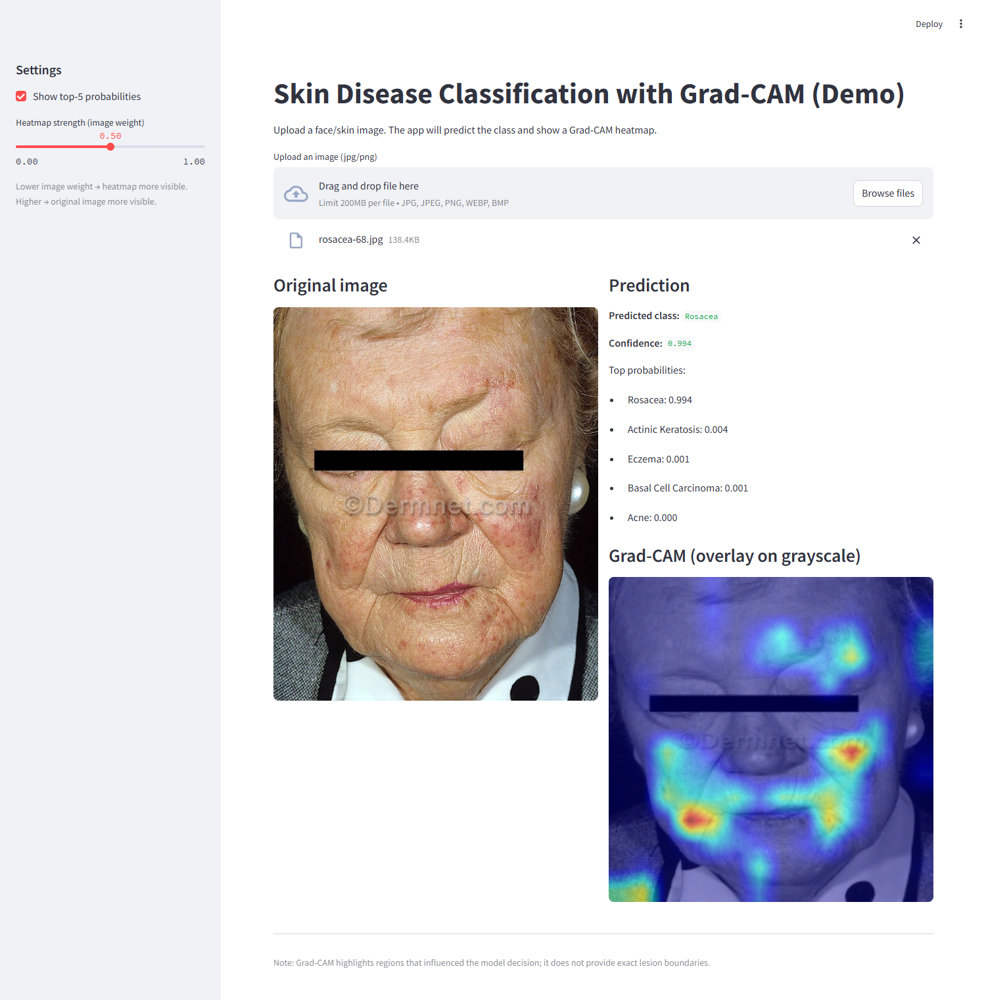
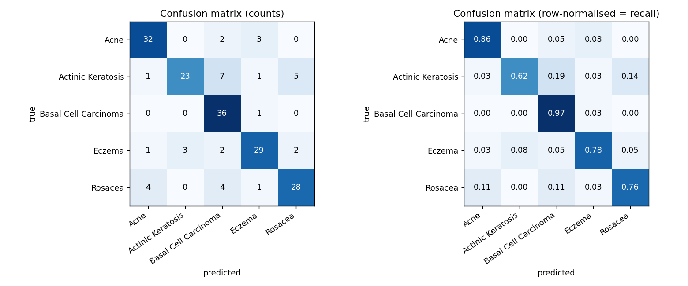
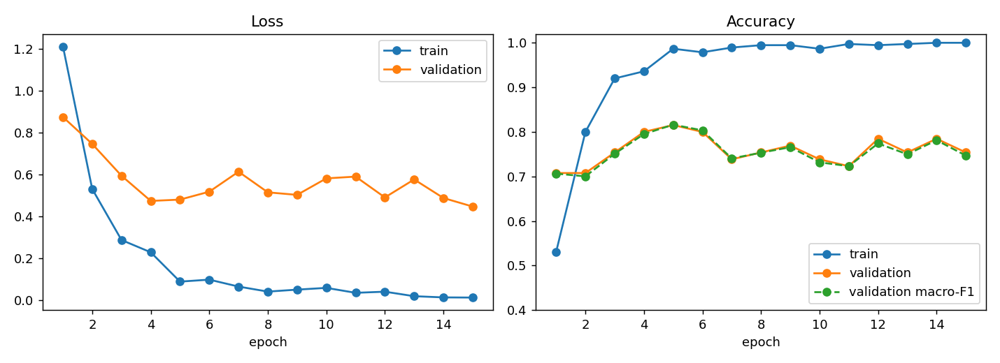
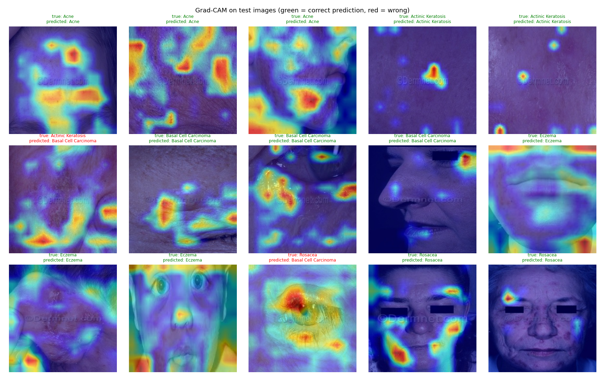
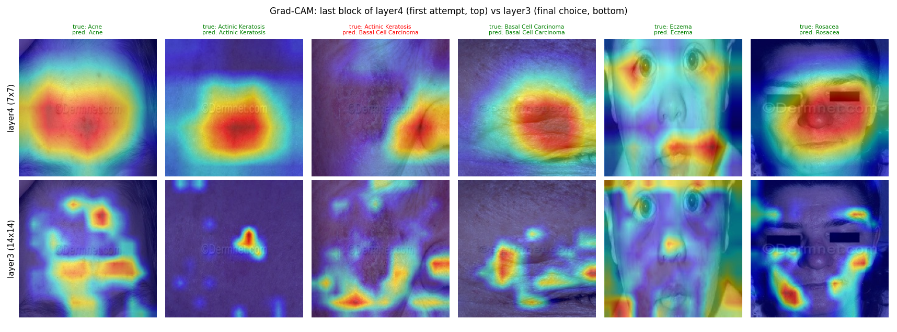
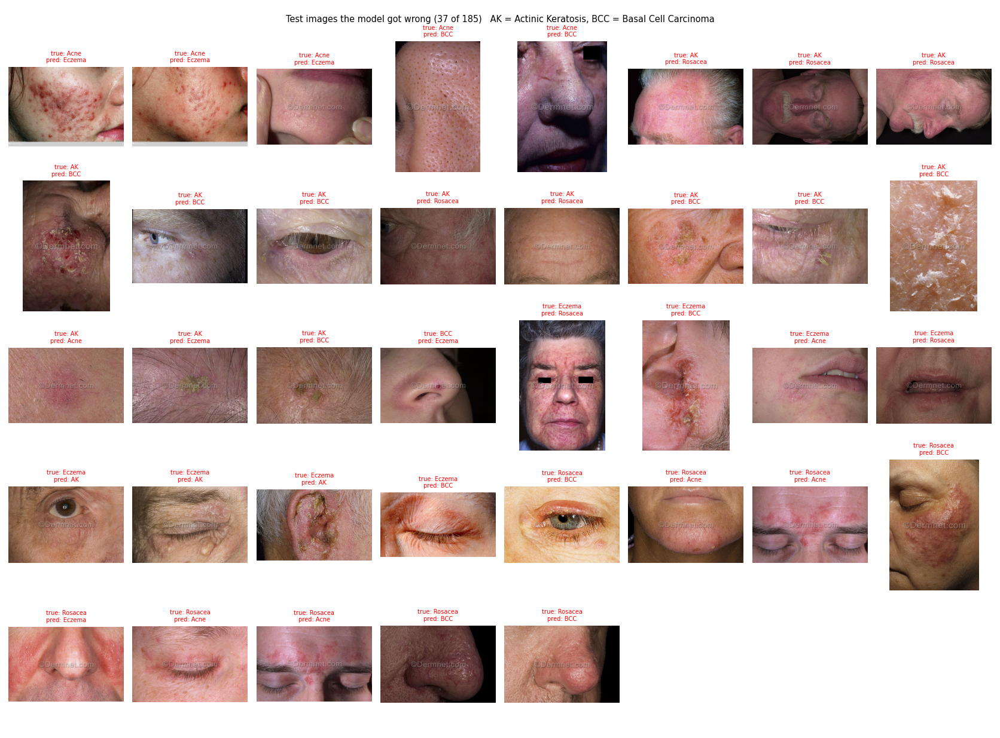
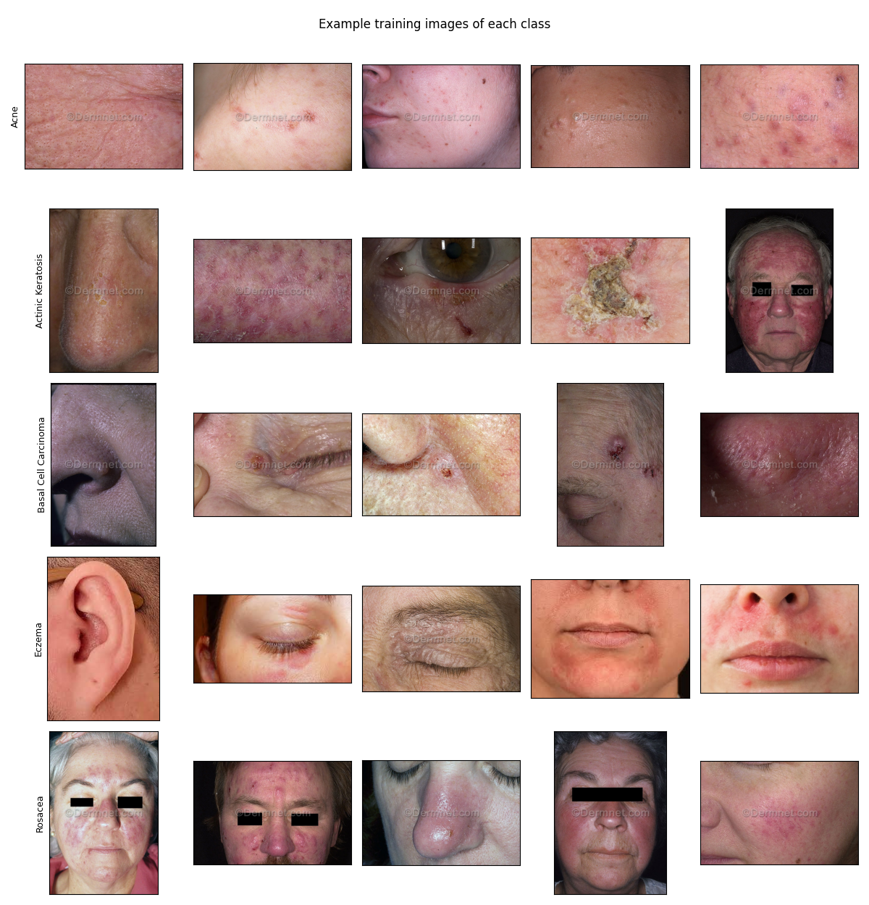

# Explainable Skin Disease Classification

Classify **five facial skin conditions** from a photo with a fine-tuned ResNet18, and **show why** with Grad-CAM heatmaps. Includes a Streamlit demo where you upload an image and see the prediction, the class probabilities and the explanation.

> Bachelor's thesis project: *analysis of facial skin images for identifying several skin conditions using deep learning and explainability methods.*
>
> Developed between **December 2025 and mid-2026**; this repository adds an organised project structure, reproducible evaluation scripts and documentation (October 2026).


> **Not a medical device.** This is a research and learning project. It must not be used for diagnosis or treatment decisions.

<p align="center"></p>

## Contents

- [Results](#results) · [Explainability](#explainability-grad-cam) · [Error analysis](#error-analysis) · [Demo](#demo-app) · [Dataset](#dataset) · [Method](#method) · [Getting started](#getting-started)
- [Thesis (English and Persian)](docs/thesis) · [Model card](docs/MODEL_CARD.md) · [Dataset card](data/README.md) · [Notebook walkthrough](notebooks/results_walkthrough.ipynb)

## Results

Held-out **test set of 185 images** (37 per class, never used for training or model selection):

| | |
|---|---|
| **Accuracy** | **80.0%** |
| **Macro F1** | **0.797** |
| Chance level (5 balanced classes) | 20% |

| Class | Precision | Recall | F1 | Test images |
|---|---|---|---|---|
| Acne | 0.84 | 0.86 | 0.85 | 37 |
| Actinic Keratosis | 0.88 | **0.62** | 0.73 | 37 |
| Basal Cell Carcinoma | **0.71** | 0.97 | 0.82 | 37 |
| Eczema | 0.83 | 0.78 | 0.81 | 37 |
| Rosacea | 0.80 | 0.76 | 0.78 | 37 |



What the confusion matrix shows:
- **Actinic Keratosis is the hardest class** (recall 62%): 7 of 37 are called Basal Cell Carcinoma and 5 Rosacea.
- Basal Cell Carcinoma has very high recall (97%) but lower precision (71%): the model tends to answer "BCC" when unsure, mostly for Actinic Keratosis and Rosacea images.
- Acne has the best F1 (0.85), followed by Basal Cell Carcinoma (0.82) and Eczema (0.81).

### Training



Training accuracy climbs towards 100% while validation accuracy stays between about 71% and 82% after the first epochs: the model overfits the small training set (375 images). The checkpoint with the best validation macro-F1 is kept.

## Explainability (Grad-CAM)

For every prediction, Grad-CAM highlights the image regions that pushed the network towards its chosen class. The heatmap is computed on the last block of `layer3` of ResNet18, and the demo shows it on a grayscale copy of the photo so that the colours of the heatmap are not mixed with the colours of the skin.



### Which layer? `layer4` versus `layer3`

The first attempt used the last block of `layer4`. Its 7×7 maps are very coarse (one large blob in the middle of the face). Moving to `layer3` (14×14) gives much finer maps that follow individual lesions, spots and reddened areas:



Heatmaps often concentrate on lesions, but not always: some maps are diffuse or fall on background and skin texture. Grad-CAM shows *where the model looked*, not exact lesion boundaries, and it does not prove the model is right.

## Error analysis

37 of the 185 test images are misclassified. The most frequent confusions are Actinic Keratosis → Basal Cell Carcinoma (7), Actinic Keratosis → Rosacea (5), Rosacea → Basal Cell Carcinoma (4) and Rosacea → Acne (4). Many of these images show small or ambiguous lesions, close-ups of a single region, or conditions that really look alike (scaly, red patches around the eyes or nose). All errors, with their predictions, are in [`outputs/test_predictions.csv`](outputs/test_predictions.csv):



## Demo app

```bash
streamlit run app/app_streamlit.py
```

Upload a face or skin photo (a few samples are in [`samples/`](samples)). The app shows the original image, the predicted class and confidence, the top-5 probabilities and a Grad-CAM overlay on a grayscale copy of the image, with an adjustable heatmap strength (see the screenshot at the top).

## Dataset

Kaggle [`amellia/face-skin-disease`](https://www.kaggle.com/datasets/amellia/face-skin-disease): **625 photos** of five conditions, split into train / validation / test:

| Split | Per class | Total |
|---|---|---|
| Train | 75 | 375 |
| Validation | 13 | 65 |
| Test | 37 | 185 |

The validation split was created from the training folder with `scripts/make_val_and_fix_folders.py` (15%, seed 42). The images are included in `data/` so that all results can be reproduced. They appear to come from DermNet (the images carry its watermark) and belong to their original owners; please check the source's terms before reusing them. More in the [dataset card](data/README.md).



## Method

| | |
|---|---|
| Model | ResNet18, ImageNet-pretrained, final layer replaced by a 5-way linear layer; all layers fine-tuned |
| Input | 224 × 224, ImageNet mean/std normalisation |
| Training augmentation | horizontal flip, rotation ±7°, colour jitter (brightness/contrast 0.15, saturation 0.10) |
| Optimiser | Adam, learning rate 1e-4, batch size 16, 15 epochs |
| Model selection | best validation macro-F1 |
| Explanation | Grad-CAM (`pytorch-grad-cam`) on `layer3[-1]` |

The full write-up (motivation, literature review, methodology, results, limitations) is the bachelor's thesis, available in [English](docs/thesis/en/thesis-en.pdf) and [Persian](docs/thesis/fa/thesis-fa.pdf). Some detailed numbers in the thesis tables differ slightly from the ones above, which are reproduced from the files in this repository; see the [note on the numbers](docs/thesis/NOTE_ON_NUMBERS.md).

## Getting started

```bash
pip install -r requirements.txt
```

```bash
python scripts/check_data_structure.py   # sanity check of data/ (images per split and class)
python src/train_baseline.py             # train, writes outputs/best_resnet18.pth and outputs/training_log.csv
python src/evaluate.py                   # re-evaluate the checkpoint, writes metrics, predictions and the confusion matrix
python src/gradcam_generate.py           # Grad-CAM images for a few test images per class -> outputs/gradcam/
python scripts/make_figures.py           # figures used in this README -> docs/
```

To fetch the dataset again instead of using the copy in `data/`, run `python scripts/download_dataset.py` (uses `kagglehub`; you need a Kaggle account). A GPU is used automatically when available.

## Project structure

```
.
├── app/app_streamlit.py            Streamlit demo (prediction + Grad-CAM)
├── src/
│   ├── train_baseline.py           training and evaluation of ResNet18
│   ├── evaluate.py                 re-evaluates the saved checkpoint
│   └── gradcam_generate.py         Grad-CAM images for test samples
├── scripts/                        data helpers and figure generation
├── notebooks/results_walkthrough.ipynb   tour of the results (no training needed)
├── data/{train,val,test}/<class>/  images (+ data/README.md)
├── outputs/                        checkpoint, training log, metrics, predictions, Grad-CAM images
├── samples/                        a few images to try in the demo
└── docs/                           figures, model card and the thesis (English and Persian)
```

## Limitations

- **Small dataset**: 375 training images and only 65 validation images. The validation set is also used to pick the checkpoint, so its score is optimistic; the test set is the number to trust, and with 185 images a one-image change moves accuracy by about 0.5 points.
- **Possible leakage**: the dataset contains a few duplicated images (7 groups, 2 of them spread across different splits), and the split is by image, not by patient.
- **Web-sourced photos**, not clinical data, with visible watermarks. The model may partly rely on image style rather than on the skin condition itself.
- Single training run, no fixed random seed, no cross-validation, so run-to-run variation is unknown.
- The validation figures in `outputs/training_log.csv` (e.g. 0.815 at the best epoch) are slightly higher than a re-evaluation of the saved checkpoint on the current `data/val` (0.785), because the validation folder was modified after training. Test results are identical in both.
- Grad-CAM is a qualitative tool here; no quantitative evaluation of the explanations was done.

## Future work

- Larger and cleaner data: remove duplicates, split by patient, add more examples for Actinic Keratosis
- Stronger backbones (EfficientNet, ConvNeXt, ViT) and class-balanced or focal loss
- Fixed seeds, repeated runs and cross-validation to report confidence intervals
- Probability calibration and an "uncertain" option, which matters for medical use
- Quantitative evaluation of explanations (deletion / insertion metrics) and comparison with other methods (Grad-CAM++, Score-CAM)
- Deploy the demo (Hugging Face Spaces or Streamlit Community Cloud)

## License

The source code is released under the [MIT License](LICENSE). The images in `data/` and the example outputs derived from them belong to their original owners.
